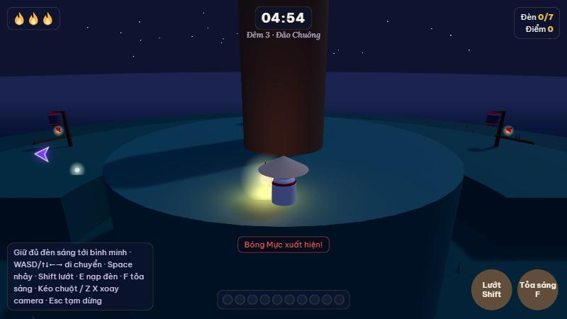

# Đảo Đèn Lồng — v1.0.0

A small 3D night game made for the Day 12 AI SDLC lab. Mây, the young lantern keeper, gathers fireflies across a floating island and keeps the Great Lanterns burning until dawn while Bóng Mực, ink shades from the black fog, try to drain them dry.



## Quick start (3 commands)

```bash
git clone https://github.com/aialphaproduct/K5-L3A-DAY12-LuuThanhMy-2A202603532-AI-SDLC.git && cd K5-L3A-DAY12-LuuThanhMy-2A202603532-AI-SDLC
python3 -m pip install -r requirements.txt
python3 main.py
```

`python3 main.py` starts the game server and opens `http://localhost:8787/` in your browser.

- **What runs where:** the browser renders the game in 3D with Three.js. The Python simulation that drives it is the same code the headless grader runs.
- **Internet:** the first page load fetches Three.js and two Google Fonts. After that everything runs locally.
- **Optional desktop client:** `python3 main.py --native` opens a Ursina window. It needs the `ursina` package from `requirements.txt`.
- **Docker:** `docker build -t dao-den-long . && docker run -p 8787:8787 dao-den-long`, then open `http://localhost:8787/`.

## System requirements

- Python 3.10+ on macOS, Linux or Windows.
- A browser with WebGL 2 (Chrome, Edge, Firefox or Safari, recent versions).
- `ursina` (pulled in by `requirements.txt`) is only needed for `--bench` and `--native`. The web game and the headless/soak runners use only the Python standard library.

## How to play

Keep the island lit until dawn. At dawn you win if at least 60 % of the lanterns are burning: 3 of 5, 4 of 6 or 5 of 7.

1. Walk over fireflies to collect them. You can carry 10 at first, plus 2 for every lantern you light, up to 20.
2. Press **E** next to a lantern to deposit fireflies.
   - A new lantern needs 10 to light.
   - A lantern that has burned out before needs only 5 to relight.
   - On a lantern that is already lit, E tops up its oil. Each firefly adds 10 oil.
3. A lit lantern burns 1 oil per second. When its oil drops below 30, it blinks, loses its safe zone, and shades come to drain it.
4. Press **F** to Tỏa Sáng: it costs 3 fireflies and stuns and pushes back every shade within 5 m. A touch from a shade costs one flame (you have 3). Falling off the island also costs one.
5. Nights 2 and 3 add Gió Lạc ribbons that steal fireflies, Bùa Gió charms that make you faster, jump pads, and Night 3's three tiers with wind gusts.

| Action | Default key |
|---|---|
| Move (relative to camera) | W A S D or arrow keys |
| Jump / Dash | Space / Shift |
| Deposit or refuel | E |
| Tỏa Sáng (pulse) | F |
| Rotate camera | Mouse drag or Z / X; mouse wheel zooms |
| Pause | Esc or P |

Every action can be rebound in **Settings → Phím**. The game warns you about duplicate keys, and "Khôi phục mặc định" restores the defaults.

Choose **Demo tự động** on the main menu for a looping showcase of all three nights. The bot plays for about 27 seconds, then shows a real dawn victory for 3 seconds before moving to the next night. Press **Esc** or **Thoát demo** to return to the menu.

**Accessibility settings** are saved in the browser and include:
- Volume and mouse sensitivity.
- A colour-blind palette (cyan shade eyes, white ⚠ warnings).
- Reduced motion (no screen flash or bobbing).
- Large text (×1.25). UI text is at least 18 px at 1280×720.
- On-screen captions for shade spawns (with an edge arrow), incoming wind, the last 10 s, and low-oil or burnt-out lanterns.

### Scoring

| Event | Points |
|---|---|
| Each firefly deposited (light, relight, refuel) | +5 |
| First light / relight | +100 / +40 |
| Shade hit by Tỏa Sáng | +5 (+15 if it was draining) |
| On a won dawn: each lit lantern | +50 + floor(oil) |
| On a won dawn: each flame left | +50 |

The game total is the sum of the nights you won. After Bình Minh (winning Night 3), or after any loss, enter a name (3–12 letters, digits or `_`; Vietnamese letters are accepted) to save to the local top-10 leaderboard. It is stored at `~/.dao-den-long/leaderboard.json`, and you can override the path with `DDL_LEADERBOARD`.

## Tests, headless, bench, soak

```bash
python3 -m unittest discover -s tests          # 47 tests, Contract v1.0-v1.3 plus demo
python3 main.py --headless --seed 1 --night 1 --ticks 600 --out run.jsonl
python3 main.py --bench --seed 42 --duration 30 --out bench.json
python3 main.py --soak --seed 7 --nights 10 --out soak.json
python3 main.py --export-leaderboard out.json
```

- **Headless** follows Test Contract v1.3 (see `game.contract.json`). It is deterministic per seed, scenario and inputs. A full night runs in about 1–3 s.
- **Bench** opens a 1280×720 Ursina window with vsync off (both through Ursina and Panda3D `sync-video #f`). It loads the standard scene: Night 1, 200 wander shades, 100 fireflies, and L1–L3 lit. The camera orbits at radius 30 m and height 15 m. After a 3 s warm-up it measures for `--duration` seconds and writes `bench.json`.
  - The bench uses the native Ursina renderer, because the web client runs inside a browser and cannot report process RSS.
  - `load_ms` is measured from when the Python entry point is imported, not from the OS process start.
- **Soak** runs nights 1→2→3 in a loop inside one process with seeded random input, and writes `soak.json` with RSS at the start and end.

Measured results are in `docs/proof/phase-4.md`.

## Project layout

| Path | What it is |
|---|---|
| `simulation.py` | The game rules (60 Hz fixed tick) and the headless runner |
| `main.py` | Entry point: game, `--headless`, `--bench`, `--soak`, `--export-leaderboard`, `--native` |
| `server_preview.py` | Runs the simulation and serves the web client (`/` 3D, `/2d` canvas) |
| `web3d.html` | Three.js client: menus, HUD, sound, settings, leaderboard |
| `bench.py`, `perf.py`, `leaderboard.py` | Ticket-04 bench, soak and memory helpers, local leaderboard |
| `visual.py` | Optional Ursina desktop client |
| `tests/` | Headless scenario tests per phase |
| `docs/` | Phase evidence (`proof/`), ADR, retro, screenshot |
| `AGENTS.md` | Harness rules for the AI agent |

## Sáng tạo của tôi

- Mây's lantern hat, glowing fireflies, and a small WebAudio soundscape (night pad and synthesized effects, no sound files).
- Ông Đăng introduces each night.
- The camera-relative third-person view with an off-screen arrow to the lantern that needs you most.

These are visual or audio only. The headless output is unchanged, and the full test suite still passes (see `docs/proof/`).

## More

- `CHANGELOG.md`: changes per phase.
- `CREDITS.md`: libraries, fonts and AI tools.
- `LICENSE`: MIT.
- `docs/retro.md`: the retrospective.
- Lab material: [GUIDE.md](GUIDE.md), [CHECKPOINTS.md](CHECKPOINTS.md), [SUBMISSION.md](SUBMISSION.md), [RULES.md](RULES.md), [RUBRIC.md](RUBRIC.md).
- The video demo is attached to the GitHub Release `v1.0.0`.
